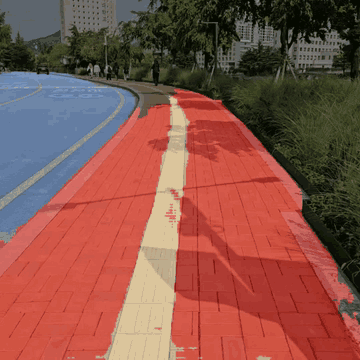
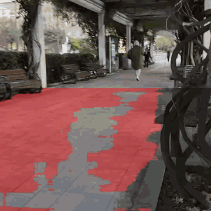

# dream – 시각장애인 길안내 보행보조 시스템

**드림학기(2024)** 에 진행한 프로젝트로, 시각장애인이 보도를 안전하게 걸을 수 있도록
카메라와 2D LiDAR로 주변 보행 환경을 인식하고, 그 결과를 WebSocket으로 전달하는 **ROS 2 기반 보행보조 시스템**입니다.

저장소는 두 부분으로 나뉩니다.

| 구분 | 위치 | 내용 |
| --- | --- | --- |
| **Jetson 실행 코드** | `dream_final/` | 실제 Jetson에 올려 실행한 ROS 2 노드 (카메라·LiDAR 입력 → 인지 → 결과 전송) |
| **모델 학습 · 캘리브레이션** | `calib/`, `unet/`, `yolov5-master/`, `fusion/` | PC에서 모델을 학습·테스트하고 카메라/LiDAR 캘리브레이션을 수행한 코드 |

- **인도에서 벗어나고 있는가** – U-Net 노면 세그멘테이션으로 인도/차도를 구분해 이탈 여부와 방향(왼쪽·오른쪽) 판단
- **앞에 무엇이 있는가** – YOLOv5로 보행 경로 위 장애물(볼라드) 실시간 탐지
- **얼마나, 어느 쪽에 있는가** – LiDAR 포인트를 카메라 영상에 투영해 탐지된 장애물의 **거리(m)와 방향(왼쪽/정면/오른쪽)** 계산

## 결과

<p align="center">
  
  
</p>

U-Net 노면 세그멘테이션 결과입니다. 빨간색이 보도블록으로 인식된 영역이고, 차도·점자블록·화단은 다른 영역으로 분리됩니다.
오른쪽은 화면 하단(발 앞쪽)만 추론하는 ROI 버전으로, 벤치와 나무 같은 장애물이 보도 영역에서 빠지는 것을 볼 수 있습니다.

## 시스템 구성

```
 USB Camera ─▶ camera_node ──/camera/image_raw──┬──▶ yolo_node ──/yolov5/detections──┐
                                                │                                     ▼
 RPLiDAR ───▶ rplidar_ros ──/scan───────────────┼──────────────────────────────▶ fusion_node
                                                │                                     │ /fusion_results
                                                │                                     ▼
                                                │                               websocket1 ──▶ /websocket1
                                                │
                                                └──▶ unet_node ──/unet/predictions──▶ sidewalk_node
                                                                                      │ /sidewalk/boundary_status
                                                                                      ▼
                                                                                websocket2 ──▶ /websocket2
```

| 토픽 | 타입 | 내용 |
| --- | --- | --- |
| `/camera/image_raw` | `sensor_msgs/Image` | 카메라 영상 (10 Hz) |
| `/scan` | `sensor_msgs/LaserScan` | RPLiDAR 스캔 |
| `/yolov5/detections` | `std_msgs/String` (JSON) | `{"detections": [{"bbox": [x1,y1,x2,y2], "confidence": 0.9, "class_name": "bollard"}]}` |
| `/unet/predictions` | `std_msgs/String` (JSON) | 세그멘테이션 결과를 10×10으로 줄인 RGB 마스크 `{"mask": [[[r,g,b], ...], ...]}` |
| `/unet/segmented_image` | `sensor_msgs/Image` | 원본 크기 컬러 세그멘테이션 마스크 |
| `/sidewalk/boundary_status` | `std_msgs/String` (JSON) | `{"status": "on"/"off", "direction": "center"/"left"/"right"/"unknown"}` |
| `/fusion_results` | `std_msgs/String` | `Object: bollard, Distance: 1.23m, Direction: center` |
| `/websocket1`, `/websocket2` | `std_msgs/String` | 장애물 정보 / 인도 이탈 정보를 WebSocket 연동용으로 재발행 |

## Jetson 실행 코드 (`dream_final/`)

실제로 Jetson에서 실행한 최종 노드 7개입니다. 각 파일 맨 위에 역할과 구독/발행 토픽을 적어 두었습니다.

| 노드 | 설명 |
| --- | --- |
| `camera_node.py` | 카메라(0번)를 열어 10 Hz로 `/camera/image_raw` 발행 |
| `yolo_node.py` | YOLOv5 커스텀 모델(`best.pt`, 볼라드)로 탐지. 추론을 **별도 스레드 + 프레임 큐**로 분리해 속도를 개선했고, confidence ≥ 0.8만 JSON으로 발행 |
| `unet_node.py` | U-Net(`unet129.h5`, 입력 128×128)으로 22개 노면 클래스 예측. 결과를 **10×10 격자로 축소**해 가볍게 발행 |
| `sidewalk_node.py` | 10×10 마스크의 **하단 4행(발 앞쪽)** 을 좌/우 절반으로 나눠 인도 픽셀 비율(≥ 40%)을 계산하고, 인도 위 여부(`on`/`off`)와 이탈 방향(`left`/`right`) 판단 |
| `fusion_node.py` | LiDAR 점을 영상에 투영해 YOLO 바운딩박스 안에 들어온 점(먼 쪽 35% 제외)으로 장애물의 **거리·각도** 계산, 각도로 방향 결정 (±15° 정면, 15~40° 왼쪽/오른쪽) |
| `websocket1.py` | `/fusion_results` → `/websocket1` 재발행 (장애물 정보) |
| `websocket2.py` | `/sidewalk/boundary_status` → `/websocket2` 재발행 (인도 이탈 정보) |

`dream_final/dev/` 에는 개발 중 이전 버전과 테스트용 코드를 모아 두었습니다.

| 파일 | 설명 |
| --- | --- |
| `yolo_node_v1_no_thread.py` | 스레딩 적용 전 YOLO 노드 (약 10 fps) |
| `unet_node_v1_fullmask.py` | 256×256 입력, 원본 크기 마스크 전체를 JSON으로 보내던 버전 |
| `fusion_node_v1.py`, `fusion_node_v2.py` | 이전 퓨전 노드 (카메라 좌표에서 거리 계산, 라디안 기준 방향 판단) |
| `websocket_publish_v1.py` | rosbridge JSON 형식으로 감싸 보내던 버전 (파싱 실패로 websocket1/2로 교체) |
| `image_publisher.py` | 간단한 카메라 발행 노드 |
| `unet_video_node.py`, `5.mp4` | 카메라 대신 동영상으로 세그멘테이션 테스트 |
| `lidar_distance.py`, `lidar_distance2.py` | LiDAR만으로 가장 가까운 장애물 거리·각도 출력 테스트 |

### 캘리브레이션 값

- 카메라 내부 파라미터 (640×480): fx = 390.20, fy = 390.02, cx = 321.55, cy = 238.40
- LiDAR → 카메라 외부 파라미터 (R, t): 2D 영상 좌표 ↔ 3D LiDAR 좌표 대응점으로 `solvePnP` 계산 (`fusion/.../cam_cali.py`)

---

## 모델 학습 · 캘리브레이션 코드

Jetson에 올리기 전에 PC에서 모델을 학습·테스트하고, 센서 캘리브레이션 값을 구한 코드입니다.
여기서 나온 가중치와 캘리브레이션 값이 `dream_final/` 노드에 들어갑니다.

| 폴더 | 내용 |
| --- | --- |
| `calib/` | 체스보드(내부 코너 9×7, 1.76 cm)로 카메라 내부 파라미터 계산 → `camera_matrix.npy`, `dist_coeffs.npy`. ROS 2 `v4l2_camera` launch 파일 |
| `unet/` | 노면 세그멘테이션 이미지·동영상 추론 실험. **frame skip**(5프레임마다 추론)과 **ROI**(화면 하단만 추론)로 속도 개선 실험. 테스트 영상 `testimage/` (건국대 주변 보도, 보도 이탈 영상) |
| `yolov5-master/` | Ultralytics YOLOv5 + 직접 추가한 `detectbollard.py`(웹캠 볼라드 탐지, FPS 표시), `detectFPS.py` |
| `fusion/`, `calib/rplidar_camera_calibration-main/` | RPLiDAR–카메라 캘리브레이션 참고 코드(ROS 1)와 ROS 2로 옮기던 버전 |

### 노면 세그멘테이션 클래스 (22개)

배경, 보도(블록·시멘트·우레탄·아스팔트·흙/돌·파손·기타), 점자블록(정상·파손), 차도(일반·횡단보도),
이면도로(일반·횡단보도·과속방지턱·파손), 자전거도로, 주의구역(계단·맨홀·가로수·그레이팅·공사구역)

### 학습 모델

| 파일 | 모델 | 클래스 |
| --- | --- | --- |
| `unet129.h5` (최종), `unet128.h5`, `925PM.h5`, `best33.h5` | U-Net | 노면 22 class |
| `pspunet_weight.h5`, `pspnet_mode6l.h5` | PSPNet 계열 | 노면 |
| `best.pt` (최종) = `bollard_best.pt` | YOLOv5 | bollard |
| `best_person.pt` / `best_car.pt` / `best_3.pt` | YOLOv5 | Person / cars, truck / Bus, Human, MotorBike, Sedan, Truck 등 10 class |

> 가중치 파일(`*.h5`, `*.pt`)은 용량 문제로 저장소에 포함되어 있지 않습니다 (`.gitignore`).
> 코드 안의 경로는 작업했던 PC(`/home/rth/...`)와 Jetson(`/home/d/d_ws/src/dr/...`) 기준입니다.

## 개발 환경

- 실행: NVIDIA Jetson, Ubuntu, ROS 2
- 학습 · 캘리브레이션: Ubuntu PC, Python 3
- TensorFlow 2.17 / Keras 3.5 (U-Net), PyTorch (YOLOv5), OpenCV 4.10, `cv_bridge`
- 센서: USB 카메라, RPLiDAR

## Credits

- [ultralytics/yolov5](https://github.com/ultralytics/yolov5) (AGPL-3.0)
- rplidar_camera_calibration 참고 코드, `camera.launch.py` (© Tinker Twins, BSD)
